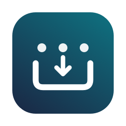

# TuckBar · 藏栏



**把菜单栏图标藏起来，点击一下，在下方收纳框里使用。**

A native macOS menu bar utility with a separate popup for hidden menu bar items.


## 使用

1. 打开 TuckBar，点击「整理」。
2. 按住 **⌘**，把分隔线 `│` 放到 TuckBar 图标左侧，再把希望隐藏的图标拖到 `│` 左侧。
3. 点击「整理完成，收起图标」。
4. 点击菜单栏中的 TuckBar 图标，下方出现收纳浮层；再点一次关闭。
5. 在浮层里点击 App 图标，操作它原来的菜单栏图标。右键该图标可打开对应 App。

浮层没有标题栏或左上角的关闭、最小化、全屏按钮。点击外部或按 **Esc** 也会收起。从「应用程序」再次打开已运行的 TuckBar，也会显示浮层。

右键菜单栏 TuckBar 图标可以打开收纳面板、在原菜单栏展开/收起、重新整理或退出。退出会移除分隔项、恢复菜单栏空间。

## 权限

- **辅助功能**：操作其他 App 的菜单栏图标。点击面板里的授权按钮，在系统设置中手动允许后返回刷新。
- **屏幕录制（可选，macOS 14+）**：使用 ScreenCaptureKit 读取单个菜单栏图标窗口的画面；不授权时显示对应 App 图标。

图标画面只在内存中使用，不落盘、不上传。没有第三方依赖或联网代码。权限仅由用户在系统设置中开启。授权后若未立即生效，请退出并重新打开 TuckBar。

## 构建与运行

需要 **macOS 13+** 和 **Swift 6 工具链**（例如 Xcode 16+）。

```sh
git clone https://github.com/yestark/TuckBar.git
cd TuckBar
./scripts/build-app.sh
open dist/TuckBar.app
```

也可从 [GitHub Releases](https://github.com/yestark/TuckBar/releases/latest) 下载 Apple Silicon / Intel 通用版，解压后将 `TuckBar.app` 拖入「应用程序」。

将 `dist/TuckBar.app` 复制到「应用程序」即可使用。Xcode 可直接打开 `Package.swift`。

构建脚本生成当前 Mac 架构的二进制，进行本地 ad-hoc 签名并验证。当前没有 Developer ID 签名或 Apple 公证；重新构建后的权限可能需要在系统设置中重新授权。

## 实现与限制

隐藏通过扩展自身 `NSStatusItem` 分隔项宽度完成，图标移动使用 macOS 的 ⌘ 拖动。浮层独立显示隐藏区的图标，不受刘海右侧可用宽度限制。无画面权限时使用 App 图标，而不是伪装成原始菜单栏符号。

操作图标使用 Accessibility 的 `AXPress`。为兼容其他 App，操作前会临时恢复原菜单栏布局，操作后约 15 秒收起。某些 App 不提供可用的 Accessibility 菜单操作时，浮层会显示失败提示；可右键打开 App 或在原菜单栏展开。

系统固定图标和某些 App 的图标不能移动。此版本按传统 macOS 独立菜单栏图标窗口进行发现与隐藏；未来系统改变窗口结构时可能需要适配。多显示器下只收集当前 TuckBar 按钮所在菜单栏的隐藏区。

## 开发与验证

```sh
swift test
./scripts/build-app.sh
codesign --verify --deep --strict dist/TuckBar.app
```

测试覆盖收起状态、首次整理、显示器宽度与上限、浮层在左右边缘及窄屏上的位置。

手动检查：

- 点击菜单栏按钮打开，再次点击关闭，无左上角窗口按钮。
- 从「应用程序」再次打开已运行的 App 能显示浮层。
- ⌘ 拖动整理后浮层显示正确图标；点击外部及 Esc 关闭。
- 未授权时显示说明，授权后能操作第三方图标。
- 屏幕录制授权后刷新原始图标；不授权仍显示 App 图标。
- 外接屏、显示器拔插、休眠唤醒、退出恢复。

可选：`./dist/TuckBar.app/Contents/MacOS/TuckBar --diagnostics` 向标准输出报告本应用自身的分隔项宽度、按钮位置和状态。运行前先退出已有实例。

通用发布包与 SHA-256 校验文件：运行 `./scripts/package-release.sh`，产物位于 `dist/`。

图标使用 AppKit 绘制：`swift scripts/make-icon.swift`，然后运行 `iconutil -c icns Resources/TuckBar.iconset -o Resources/TuckBar.icns`。

几何隐藏方案参考 [Hidden Bar 的架构说明](https://github.com/dwarvesf/hidden/blob/develop/docs/ARCHITECTURE.md)。图标画面使用 Apple [ScreenCaptureKit](https://developer.apple.com/documentation/screencapturekit)。实现独立编写，不包含其他项目源代码。

## License

[MIT](LICENSE) © 2026 yestark
